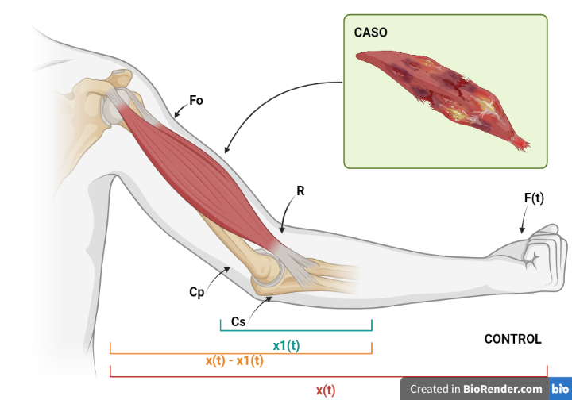
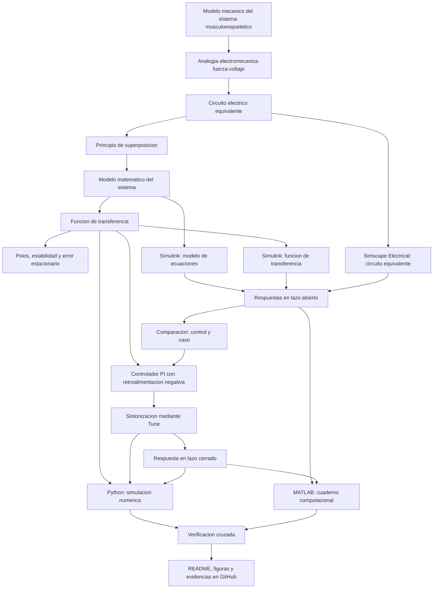

[](https://matlab.mathworks.com/open/github/v1?repo=sarag-hub/MSFP3)

# Práctica 3 — Sistema musculoesquelético

Repositorio académico de la asignatura **Modelado de Sistemas Fisiológicos**, correspondiente al programa de **Ingeniería Biomédica** del Tecnológico Nacional de México / Instituto Tecnológico de Tijuana. Esta práctica integra modelado matemático, analogías electromecánicas, análisis temporal y de estabilidad, diseño de controladores, simulación computacional y verificación cruzada de resultados.

El caso de estudio representa el **sistema musculoesquelético** mediante un modelo mecánico viscoelástico simplificado, compuesto por un elemento contráctil, un amortiguador viscoso y dos elementos elásticos. Se busca reproducir y comparar la respuesta de un individuo sano (**control**) con un caso simulado de **atrofia muscular**, tanto en lazo abierto como en lazo cerrado, mediante una estrategia de control orientada a reducir las diferencias entre ambas respuestas.

**Docente:** Dr. Paul Antonio Valle Trujillo  
**Correo:** paul.valle@tectijuana.edu.mx  
**Departamento:** Ingeniería Eléctrica y Electrónica  
**Institución:** Tecnológico Nacional de México / Instituto Tecnológico de Tijuana  
**Asignatura:** Modelado de Sistemas Fisiológicos  
**Programa:** Ingeniería Biomédica  
**Estudiante:** Sara Gutiérrez Hernández · 23212734 · l23212734@tectijuana.edu.mx

**Repositorio de la asignatura:** https://github.com/DrPaulValle/MSF-IBF1020  
**Sede:** Blvd. Alberto Limón Padilla s/n, Tijuana, C. P. 22454, B. C., México.

---

<a id="contenido"></a>
## Contenido

1. [Resumen](#resumen)
2. [Competencia y objetivos](#objetivos)
3. [Relación con el temario](#temario)
4. [Modelo físico y analogía eléctrica](#analogia)
5. [Formulación matemática](#modelo)
6. [Análisis temporal y de estabilidad](#analisis)
7. [Señales de entrada y condiciones de simulación](#senales)
8. [Implementación en MATLAB, Simulink y Simscape](#matlab)
9. [Control en lazo cerrado y sintonización PID](#pid)
10. [Reproducción en Python](#python)
11. [Controlador y experimentación in silico](#laboratorio)
12. [Resultados y verificación cruzada](#resultados)
13. [Flujo de trabajo](#flujo)
14. [Actividades del estudiante](#actividades)
15. [Estructura del repositorio](#estructura)
16. [Requisitos](#requisitos)
17. [Reproducibilidad y entregables](#reproducibilidad)
18. [Referencias](#referencias)

---

<a id="resumen"></a>
## Resumen

La práctica tiene como propósito **desarrollar un procedimiento de modelado, análisis, simulación y control** del sistema musculoesquelético mediante la experimentación *in silico*. El comportamiento mecánico se aproxima mediante un modelo viscoelástico compuesto por un elemento contráctil activo, un amortiguador viscoso de coeficiente $R$ y dos elementos elásticos caracterizados por las compliancias $C_p$ y $C_s$. Mediante la analogía fuerza-voltaje se construye un circuito eléctrico equivalente que permite formular las ecuaciones del sistema y obtener su función de transferencia aplicando el principio de superposición y la transformada de Laplace.

Se estudian el error en estado estacionario y la estabilidad de los modelos correspondientes a un **individuo sano (control)** y un **caso simulado de atrofia muscular**, representado mediante el incremento de la resistencia equivalente de $100\ \Omega$ a $10\ \mathrm{k}\Omega$. Posteriormente, se implementan las representaciones matemáticas y eléctricas en MATLAB/Simulink y Simscape Electrical para comparar sus respuestas ante una señal de entrada de tipo pulso. Se incorpora un sistema de retroalimentación negativa con un **controlador PI**, sintonizado mediante la herramienta Tune, para reducir el error entre la respuesta del caso y la referencia del individuo sano. Los resultados se reproducen mediante Python y se comparan con las simulaciones obtenidas en MATLAB.

Esta práctica corresponde a un ejercicio de **modelado y verificación computacional**. La estrategia de control desarrollada tiene fines exclusivamente académicos y de simulación, por lo que no constituye una intervención terapéutica para el tratamiento de la atrofia muscular.

**Palabras clave:** sistema musculoesquelético; modelo viscoelástico; analogía fuerza-voltaje; atrofia muscular; controlador PI; MATLAB; Simulink; Simscape Electrical; Python; simulación *in silico*.

[Volver al contenido](#contenido)

---

<a id="objetivos"></a>
## Competencia y objetivos

### Competencia a desarrollar

Modeliza sistemas fisiológicos mediante analogías entre sistemas físicos, ecuaciones diferenciales y funciones de transferencia para analizar su comportamiento dinámico y diseña estrategias de control mediante técnicas de control clásico. En particular, durante esta práctica se estudia un modelo mecánico simplificado del sistema musculoesquelético, se construye su circuito eléctrico equivalente mediante la analogía fuerza-voltaje, se compara la respuesta de un individuo sano (control) con un caso simulado de atrofia muscular (caso) y se diseña una estrategia de control *in silico* orientada a reducir las diferencias entre ambas respuestas.

### Objetivo general

Modelar y analizar el comportamiento dinámico del sistema musculoesquelético mediante su representación mecánica viscoelástica, la formulación matemática y la implementación de un circuito eléctrico equivalente, comparando las respuestas de un individuo sano y un caso simulado de atrofia muscular, así como diseñar y verificar un sistema de control con retroalimentación mediante MATLAB/Simulink, Simscape Electrical y Python.

### Objetivos específicos

- Identificar los elementos del modelo mecánico simplificado del sistema musculoesquelético y describir sus propiedades contráctiles, viscosas y elásticas.
- Construir el circuito eléctrico equivalente mediante la analogía fuerza-voltaje, considerando las correspondencias entre los elementos mecánicos y eléctricos.
- Formular las ecuaciones del sistema y obtener su función de transferencia mediante la transformada de Laplace y el principio de superposición.
- Determinar las funciones de transferencia del individuo sano (control) y del caso simulado de atrofia muscular (caso), considerando sus respectivos parámetros.
- Calcular el error en estado estacionario, determinar los polos y analizar la estabilidad de ambas condiciones.
- Implementar los modelos matemáticos, las funciones de transferencia y el circuito eléctrico equivalente mediante MATLAB/Simulink y Simscape Electrical.
- Comparar las respuestas en lazo abierto del control y del caso ante una señal de entrada tipo pulso.
- Diseñar un sistema de retroalimentación negativa y sintonizar un controlador mediante la herramienta Tune de Simulink para reducir el error entre ambas respuestas.
- Obtener las respuestas del control, caso y sistema controlado mediante un cuaderno computacional de MATLAB.
- Reproducir las funciones de transferencia y las respuestas del sistema mediante Python para verificar la consistencia de los resultados obtenidos.
- Elaborar un diagrama biológico que relacione los elementos del modelo con las estructuras fisiológicas del sistema musculoesquelético.
- Documentar el análisis matemático, los modelos computacionales, las simulaciones y los resultados en un repositorio de GitHub.

[Volver al contenido](#contenido)

---

<a id="temario"></a>
## Relación con el temario

La práctica integra contenidos de la asignatura **Modelado de Sistemas Fisiológicos (IBF-1020)** relacionados con el modelado matemático de sistemas fisiológicos, la representación mediante circuitos eléctricos equivalentes y el diseño de controladores clásicos.

| Área | Contenidos aplicados |
|---|---|
| Sistemas de control retroalimentados | Diagramas de bloques, sistemas en lazo abierto y cerrado, señales de referencia, error y respuesta temporal |
| Modelado matemático | Analogía fuerza-voltaje, formulación de ecuaciones, principio de superposición, transformada de Laplace y funciones de transferencia |
| Análisis de sistemas | Polos, estabilidad, comportamiento transitorio y error en estado estacionario |
| Controladores | Diseño del sistema de retroalimentación, sintonización de ganancias y análisis de la respuesta controlada |
| Simulación computacional | MATLAB, Simulink, Simscape Electrical y Python para la implementación y verificación de los modelos |

El enfoque combina los principios de la **Ingeniería de Control, la Electrónica Analógica, las Ciencias de la Computación y la Fisiología**, permitiendo establecer relaciones cuantitativas entre el comportamiento mecánico del sistema musculoesquelético y su representación mediante modelos matemáticos y circuitos eléctricos equivalentes.

[Volver al contenido](#contenido)

---


<a id="analogia"></a>
## Modelo físico y analogía eléctrica

El sistema musculoesquelético se aproxima mediante un modelo mecánico viscoelástico simplificado, compuesto por un elemento contráctil activo, un amortiguador viscoso y dos elementos elásticos. La fuerza desarrollada por el elemento contráctil $F_0(t)$ se relaciona con la fuerza transmitida $F(t)$ mediante el coeficiente $\alpha$, mientras que los componentes $R$, $C_p$ y $C_s$ representan las propiedades viscosas y elásticas del tejido muscular y tendinoso.

La relación entre la fuerza activa y la fuerza aplicada al sistema se establece mediante

$$
F_0(t)=\alpha F(t), \qquad 0<\alpha<1.
$$

El amortiguador $R$ representa la disipación viscosa inherente al tejido; la compliancia $C_p$ representa las propiedades elásticas del elemento paralelo y $C_s$ las del elemento en serie. El desplazamiento total se representa mediante $x(t)$ y el desplazamiento del elemento elástico en serie mediante $x_1(t)$. Por lo tanto, la deformación relativa asociada al amortiguador está dada por $x(t)-x_1(t)$.

### Analogía fuerza-voltaje

Para facilitar el análisis mediante herramientas de circuitos eléctricos, se utiliza la **analogía fuerza-voltaje**, estableciendo las siguientes correspondencias:

| Sistema mecánico | Sistema eléctrico equivalente |
|---|---|
| Fuerza $F(t)$ | Voltaje $V(t)$ |
| Velocidad $\frac{dx(t)}{dt}$ | Corriente $I(t)$ |
| Desplazamiento $x(t)$ | Carga eléctrica $q(t)$ |
| Amortiguador | Resistencia $R$ |
| Compliancia mecánica | Capacitancia $C$ |
| Masa | Inductancia $L$ |

Una consecuencia de esta analogía es que las conexiones mecánicas y eléctricas no conservan necesariamente la misma topología. Los elementos mecánicos conectados en paralelo pueden representarse mediante componentes eléctricos conectados en serie, mientras que los elementos mecánicos conectados en serie pueden representarse mediante componentes eléctricos conectados en paralelo.

La posición de la referencia mecánica y la ubicación de los desplazamientos determinan los nodos y ramas correspondientes del circuito equivalente.

### Parámetros para la simulación

Para representar un individuo sano (**control**) y un caso simulado de atrofia muscular (**caso**), se utilizan los siguientes valores:

| Parámetro | Control | Caso |
|---|---:|---:|
| $F(t)$ | $1\ \mathrm{V}$ | $1\ \mathrm{V}$ |
| $\alpha$ | $0.25$ | $0.25$ |
| $C_s$ | $10\ \mu\mathrm{F}$ | $10\ \mu\mathrm{F}$ |
| $C_p$ | $100\ \mu\mathrm{F}$ | $100\ \mu\mathrm{F}$ |
| $R$ | $100\ \Omega$ | $10\ \mathrm{k}\Omega$ |

Los valores corresponden a los parámetros del circuito eléctrico equivalente empleado durante la experimentación *in silico*. La diferencia entre el control y el caso se establece mediante el incremento de la resistencia $R$, utilizado para modificar la componente viscosa del modelo y producir una respuesta dinámica diferente.

La respuesta del individuo sano se utiliza como referencia para el sistema de control. Considerando el desplazamiento como variable de salida, la señal de error se define como

$$
e(t)=x_{\mathrm{control}}(t)-x_{\mathrm{caso}}(t).
$$

La práctica se desarrolla exclusivamente mediante experimentación *in silico*. En MATLAB/Simulink se implementan el modelo matemático, las funciones de transferencia y el sistema de control, mientras que el circuito eléctrico equivalente se construye mediante Simscape Electrical. Los resultados se verifican de manera complementaria utilizando Python.

**Alcance de la analogía:** los parámetros eléctricos representan las propiedades del modelo mecánico simplificado, pero no constituyen mediciones clínicas directas del comportamiento muscular ni de la atrofia muscular.


### Representación biológica del sistema

El diagrama biológico representa la relación entre las estructuras del sistema musculoesquelético y los elementos del modelo mecánico viscoelástico. Se identifican el elemento contráctil muscular, el amortiguamiento viscoso, las propiedades elásticas de los tejidos y tendones, así como las fuerzas y desplazamientos asociados al funcionamiento del sistema.



**Figura 1.** Representación biológica del sistema musculoesquelético y su correspondencia con el modelo mecánico viscoelástico simplificado. Elaboración mediante BioRender.


[Volver al contenido](#contenido)

---

<a id="modelo"></a>
## Formulación matemática

### 1. Ecuaciones del sistema y principio de superposición

El circuito eléctrico equivalente del sistema musculoesquelético contiene dos fuentes de voltaje: la fuerza aplicada $F(t)$ y la fuerza desarrollada por el elemento contráctil $F_0(t)$. Para determinar la respuesta total del sistema se aplica el **principio de superposición**, analizando por separado la contribución de cada fuente.

La relación entre ambas fuerzas está definida por

```math
F_0(t)=\alpha F(t).
```

La respuesta total corresponde a la suma de las contribuciones obtenidas en ambos circuitos:

```math
F_s(t)=F_{s1}(t)+F_{s2}(t).
```

**Circuito 1. Apagando la fuente $F_0(t)$**

Considerando la primera configuración del circuito equivalente, se establecen las siguientes relaciones:

```math
x(t)=x_1(t)+x_2(t),
```

```math
x(t)=C_p\frac{dF_{s1}(t)}{dt},
```

```math
x_1(t)=C_s\frac{d[F(t)-F_{s1}(t)]}{dt},
```

```math
x_2(t)=\frac{F(t)-F_{s1}(t)}{R}.
```

Sustituyendo las expresiones anteriores se obtiene

```math
C_p\frac{dF_{s1}(t)}{dt}
=
C_s\frac{d[F(t)-F_{s1}(t)]}{dt}
+
\frac{F(t)-F_{s1}(t)}{R}.
```

Aplicando la transformada de Laplace con condiciones iniciales nulas:

```math
C_psF_{s1}(s)
=
C_ss[F(s)-F_{s1}(s)]
+
\frac{F(s)-F_{s1}(s)}{R}.
```

Agrupando términos:

```math
\left(C_ps+C_ss+\frac{1}{R}\right)F_{s1}(s)
=
\left(C_ss+\frac{1}{R}\right)F(s).
```

Multiplicando por $R$ y despejando:

```math
\boxed{
F_{s1}(s)=
\frac{C_sRs+1}{R(C_p+C_s)s+1}F(s)
}
```

**Circuito 2. Apagando la fuente $F(t)$**

Para la segunda configuración se considera la contribución de la fuente contráctil, recordando que

```math
F_0(t)=\alpha F(t).
```

Las relaciones del circuito se expresan como

```math
-\alpha F(t)=Rx(t)+\frac{1}{C_p+C_s}\int x(t)\,dt,
```

```math
F_{s2}(t)=\frac{1}{C_p+C_s}\int x(t)\,dt.
```

Aplicando la transformada de Laplace:

```math
-\alpha F(s)=
\left(R+\frac{1}{(C_p+C_s)s}\right)x(s),
```

```math
F_{s2}(s)=\frac{x(s)}{(C_p+C_s)s}.
```

Al relacionar ambas expresiones y despejar se obtiene

```math
\boxed{
F_{s2}(s)=
-\frac{\alpha}{R(C_p+C_s)s+1}F(s)
}
```

### 2. Función de transferencia

La respuesta total del sistema se determina mediante la suma de las contribuciones de ambos circuitos:

```math
F_s(s)=F_{s1}(s)+F_{s2}(s).
```

Sustituyendo las expresiones obtenidas mediante el principio de superposición:

```math
F_s(s)=
\frac{C_sRs+1}{R(C_p+C_s)s+1}F(s)
-
\frac{\alpha}{R(C_p+C_s)s+1}F(s).
```

Agrupando los términos del numerador:

```math
F_s(s)=
\frac{C_sRs+1-\alpha}{R(C_p+C_s)s+1}F(s).
```

Por lo tanto, la función de transferencia del sistema musculoesquelético está dada por

```math
\boxed{
G(s)=\frac{F_s(s)}{F(s)}
=
\frac{C_sRs+1-\alpha}{R(C_p+C_s)s+1}
}
```

La función de transferencia obtenida corresponde a un **sistema de primer orden**, cuyo comportamiento dinámico depende de la resistencia $R$, las compliancias $C_p$ y $C_s$, y el coeficiente $\alpha$.

### 3. Funciones de transferencia del control y del caso

Para obtener las funciones correspondientes a las dos condiciones simuladas se utilizan los parámetros:

```math
\alpha=0.25,\qquad
C_p=100\times10^{-6}\ \mathrm{F},\qquad
C_s=10\times10^{-6}\ \mathrm{F}.
```

**Individuo sano (control)**

Considerando $R=100\ \Omega$:

```math
G_{\mathrm{control}}(s)=
\frac{(10\times10^{-6})(100)s+1-0.25}
{100(100\times10^{-6}+10\times10^{-6})s+1}.
```

Simplificando:

```math
\boxed{
G_{\mathrm{control}}(s)=
\frac{0.001s+0.75}{0.011s+1}
}
```

**Caso simulado de atrofia muscular**

Considerando $R=10\,000\ \Omega$:

```math
G_{\mathrm{caso}}(s)=
\frac{(10\times10^{-6})(10\,000)s+1-0.25}
{10\,000(100\times10^{-6}+10\times10^{-6})s+1}.
```

Simplificando:

```math
\boxed{
G_{\mathrm{caso}}(s)=
\frac{0.1s+0.75}{1.1s+1}
}
```

Ambas funciones presentan la misma ganancia estática, pero diferentes constantes de tiempo debido al incremento de la resistencia equivalente en el caso simulado de atrofia muscular.

### 4. Representación mediante ecuación diferencial ordinaria

A partir de la función de transferencia general:

```math
[R(C_p+C_s)s+1]F_s(s)
=
[C_sRs+1-\alpha]F(s).
```

Aplicando la transformada inversa de Laplace con condiciones iniciales nulas, se obtiene la ecuación diferencial:

```math
R(C_p+C_s)\frac{dF_s(t)}{dt}+F_s(t)
=
C_sR\frac{dF(t)}{dt}+(1-\alpha)F(t).
```

Despejando la derivada de la variable de salida:

```math
\boxed{
\frac{dF_s(t)}{dt}
=
-\frac{F_s(t)}{R(C_p+C_s)}
+
\frac{C_s}{C_p+C_s}\frac{dF(t)}{dt}
+
\frac{1-\alpha}{R(C_p+C_s)}F(t)
}
```

Esta representación permite describir la dinámica temporal del sistema mediante una ecuación diferencial de primer orden, equivalente a la función de transferencia utilizada en MATLAB/Simulink y Python.

[Volver al contenido](#contenido)

---

<a id="analisis"></a>
## Análisis temporal y de estabilidad

### 1. Error en estado estacionario

El error en estado estacionario permite determinar la diferencia entre la señal de entrada y la respuesta del sistema cuando el tiempo tiende a infinito. Para el modelo musculoesquelético se considera la función de transferencia obtenida mediante el principio de superposición:

```math
G(s)=\frac{F_s(s)}{F(s)}
=
\frac{C_sRs+1-\alpha}{R(C_p+C_s)s+1}.
```

Para una entrada escalón unitario:

```math
F(s)=\frac{1}{s},
\qquad
F_s(s)=G(s)\frac{1}{s}.
```

Definiendo el error entre la entrada y la salida:

```math
E(s)=F(s)-F_s(s),
```

y aplicando el teorema del valor final, siempre que se cumplan las condiciones de estabilidad:

```math
e_{ss}=\lim_{s\to0}sE(s).
```

Sustituyendo la función de transferencia:

```math
e_{ss}=
\lim_{s\to0}
s\frac{1}{s}
\left(
1-\frac{C_sRs+1-\alpha}{R(C_p+C_s)s+1}
\right).
```

Simplificando:

```math
e_{ss}=1-(1-\alpha).
```

Por lo tanto:

```math
\boxed{e_{ss}=\alpha}
```

Considerando el valor establecido para ambas condiciones:

```math
\boxed{e_{ss}=0.25}
```

La respuesta final de los modelos ante una entrada escalón unitario está dada por:

```math
F_s(\infty)=G(0)=1-\alpha=0.75.
```

Por lo tanto, el individuo sano y el caso simulado de atrofia muscular presentan el mismo valor final ante una entrada escalón unitario, debido a que la modificación de la resistencia $R$ no altera la ganancia estática del sistema.

Este resultado corresponde al error entre la entrada y la salida de los modelos en lazo abierto; no debe confundirse con el error de seguimiento del sistema con controlador.

### 2. Polos y estabilidad

La estabilidad de los modelos se analiza mediante las raíces del denominador de la función de transferencia:

```math
R(C_p+C_s)s+1=0.
```

Despejando el polo:

```math
\boxed{
\lambda=-\frac{1}{R(C_p+C_s)}
}
```

Dado que $R$, $C_p$ y $C_s$ son positivos, el polo se encuentra en el semiplano izquierdo del plano complejo, por lo que ambos modelos presentan una respuesta estable en lazo abierto.

**Individuo sano (control)**

Para $R=100\ \Omega$, $C_p=100\ \mu\mathrm{F}$ y $C_s=10\ \mu\mathrm{F}$:

```math
\lambda_{\mathrm{control}}
=
-\frac{1}{100(100\times10^{-6}+10\times10^{-6})}.
```

Por lo tanto:

```math
\boxed{
\lambda_{\mathrm{control}}=-90.909\ \mathrm{s}^{-1}
}
```

**Caso simulado de atrofia muscular**

Para $R=10\,000\ \Omega$:

```math
\lambda_{\mathrm{caso}}
=
-\frac{1}{10\,000(100\times10^{-6}+10\times10^{-6})}.
```

Por lo tanto:

```math
\boxed{
\lambda_{\mathrm{caso}}=-0.909\ \mathrm{s}^{-1}
}
```

Los dos polos son reales y negativos, por lo que ambos sistemas son estables. Sin embargo, el polo del caso se encuentra más próximo al origen del plano complejo, indicando una respuesta temporal más lenta respecto al individuo sano.

### 3. Análisis de la respuesta temporal

La constante de tiempo de cada modelo se determina mediante:

```math
\tau=R(C_p+C_s).
```

Para el individuo sano:

```math
\tau_{\mathrm{control}}
=
100(110\times10^{-6})
=
0.011\ \mathrm{s}.
```

Para el caso de atrofia muscular:

```math
\tau_{\mathrm{caso}}
=
10\,000(110\times10^{-6})
=
1.1\ \mathrm{s}.
```

| Característica | Control | Caso |
|---|---:|---:|
| Resistencia $R$ | $100\ \Omega$ | $10\,000\ \Omega$ |
| Polo $\lambda$ | $-90.909\ \mathrm{s}^{-1}$ | $-0.909\ \mathrm{s}^{-1}$ |
| Constante de tiempo $\tau$ | $0.011\ \mathrm{s}$ | $1.1\ \mathrm{s}$ |
| Ganancia estática $G(0)$ | $0.75$ | $0.75$ |
| Error en estado estacionario $e_{ss}$ | $0.25$ | $0.25$ |
| Estabilidad | Estable | Estable |

El incremento de la resistencia equivalente produce una constante de tiempo cien veces mayor en el caso simulado de atrofia muscular. Como consecuencia, su respuesta presenta una evolución más lenta ante la señal aplicada.

### 4. Predicción y comparación de las respuestas

A partir de los polos y las constantes de tiempo, se espera que el individuo sano responda rápidamente a los cambios de la señal de entrada, mientras que el caso simulado de atrofia muscular presente una respuesta más lenta debido al incremento del amortiguamiento viscoso.

Para una entrada tipo pulso de amplitud unitaria aplicada entre $t=1\ \mathrm{s}$ y $t=2\ \mathrm{s}$, ambos modelos presentan una respuesta estable. El control alcanza rápidamente un valor próximo a $0.75\ \mathrm{V}$, mientras que el caso evoluciona de manera gradual durante la aplicación del pulso y continúa disminuyendo después de que la entrada regresa a cero.

Estas diferencias permiten justificar el diseño de un controlador con retroalimentación negativa que utilice la respuesta del individuo sano como referencia para modificar el comportamiento dinámico del caso.

Las simulaciones realizadas en MATLAB/Simulink y Python permiten verificar que las diferencias entre ambas respuestas se deben principalmente a la modificación de la resistencia equivalente y su efecto sobre la constante de tiempo.

[Volver al contenido](#contenido)

---


<a id="senales"></a>
## Señales de entrada y condiciones de simulación

La simulación del sistema musculoesquelético se desarrolla en un intervalo de $0\leq t\leq10\,\mathrm{s}$, utilizando una señal de entrada tipo pulso de amplitud unitaria y duración de $1\,\mathrm{s}$. La entrada representa la fuerza aplicada al modelo mecánico mediante su equivalente eléctrico y permite comparar las respuestas del individuo sano (control), el caso simulado de atrofia muscular y el sistema controlado.

### Señal de entrada

La señal utilizada durante la experimentación *in silico* se define como:

$$
F(t)=
\begin{cases}
0, & 0\leq t<1\,\mathrm{s},\\
1, & 1\leq t<2\,\mathrm{s},\\
0, & 2\leq t\leq10\,\mathrm{s}.
\end{cases}
$$

La entrada corresponde a un pulso rectangular de amplitud $1\,\mathrm{V}$ en su representación eléctrica equivalente. Su aplicación permite analizar el comportamiento transitorio de ambos modelos durante la activación y después de retirar la fuerza aplicada.

| Parámetro | Valor | Descripción |
|---|---|---|
| Señal | Pulso rectangular | Entrada aplicada al sistema |
| Amplitud | $1\,\mathrm{V}$ | Equivalente eléctrico de la fuerza |
| Inicio del pulso | $1\,\mathrm{s}$ | Activación de la entrada |
| Final del pulso | $2\,\mathrm{s}$ | Retiro de la entrada |
| Duración | $1\,\mathrm{s}$ | Intervalo de activación |
| Tiempo de simulación | $10\,\mathrm{s}$ | Intervalo total de observación |
| Condiciones iniciales | Cero | Estado inicial de los modelos |

### Configuración de MATLAB/Simulink

En MATLAB/Simulink se utiliza el modelo `sistema4.slx`, estableciendo un tiempo final de simulación de $10\,\mathrm{s}$ y el solver `ode15s`, con un paso máximo de integración de $10^{-3}\,\mathrm{s}$.

La configuración empleada en el cuaderno computacional es:

```matlab
clc; clear; close all; warning('off','all')
open_system('sistema4')
parameters.StopTime = '10';
parameters.Solver = 'ode15s';
parameters.MaxStep = '1e-3';
parameters.TimeSaveName = 't';
x = sim('sistema4',parameters);
```

El solver `ode15s` permite resolver numéricamente las ecuaciones implementadas en Simulink. Las señales obtenidas se almacenan en el *Workspace* para su posterior representación gráfica mediante el cuaderno computacional de MATLAB.

### Configuración de Python

En Python se utiliza el mismo intervalo temporal, con un paso de discretización de $\Delta t=10^{-3}\,\mathrm{s}$ y condiciones iniciales nulas:

```python
x0,t0,tend,dt,w,h = 0,0,10,1E-3,10,5
N = round((tend-t0)/dt)+1
t = np.linspace(t0,tend,N)
u = np.zeros(N)
u[round(1/dt):round(2/dt)] = 1
```

El vector temporal contiene $10\,001$ muestras y la señal de entrada mantiene amplitud unitaria entre $1$ y $2\,\mathrm{s}$. Las funciones de transferencia del control y del caso se implementan mediante la biblioteca `control`, utilizando `forced_response` para obtener sus respuestas temporales.

### Condiciones de comparación

Las simulaciones se realizan utilizando la misma entrada y condiciones iniciales para ambos modelos. Los parámetros $\alpha$, $C_p$ y $C_s$ permanecen constantes, mientras que la resistencia $R$ se modifica para representar las dos condiciones fisiológicas.

Las respuestas que se comparan son:

1. **Entrada $F(t)$:** señal de fuerza aplicada al sistema.
2. **Control $F_{s,\mathrm{control}}(t)$:** respuesta del individuo sano en lazo abierto.
3. **Caso $F_{s,\mathrm{caso}}(t)$:** respuesta del caso simulado de atrofia muscular en lazo abierto.
4. **Sistema controlado $F_{s,\mathrm{PI}}(t)$:** respuesta del caso con controlador PI y retroalimentación negativa, utilizando la salida del individuo sano como referencia.

La comparación permite evaluar las diferencias en amplitud, velocidad de respuesta y comportamiento transitorio, así como verificar la reducción del error mediante el controlador.

[Volver al contenido](#contenido)

---


<a id="matlab"></a>
## Implementación en MATLAB, Simulink y Simscape

El sistema musculoesquelético se implementa mediante tres representaciones computacionales: el modelo obtenido a partir de las ecuaciones del sistema, la función de transferencia y el circuito eléctrico equivalente construido mediante Simscape Electrical. Estas representaciones permiten analizar y comparar el comportamiento dinámico del individuo sano (control) y del caso simulado de atrofia muscular.

| Implementación | Descripción | Aspecto por verificar |
|---|---|---|
| Modelo matemático, Simulink | Bloques que representan las ecuaciones del sistema viscoelástico | Consistencia con las relaciones mecánicas y eléctricas |
| Función de transferencia, Simulink | Implementación de $G(s)$ para las condiciones control y caso | Concordancia de las respuestas en lazo abierto |
| Circuito equivalente, Simscape Electrical | Componentes eléctricos $R$, $C_p$ y $C_s$ y fuentes correspondientes | Equivalencia con las representaciones matemáticas |

### 1. Implementación del modelo matemático

La representación matemática se obtiene a partir de la función de transferencia desarrollada mediante el principio de superposición:

$$
G(s)=\frac{F_s(s)}{F(s)}
=\frac{C_sRs+1-\alpha}{R(C_p+C_s)s+1}.
$$

En Simulink se construyen las representaciones correspondientes al individuo sano y al caso simulado de atrofia muscular, utilizando los mismos valores de $\alpha$, $C_p$ y $C_s$, y modificando únicamente la resistencia equivalente $R$.

Las funciones implementadas para ambas condiciones son:

$$
G_{\mathrm{control}}(s)=
\frac{0.001s+0.75}{0.011s+1},
$$

$$
G_{\mathrm{caso}}(s)=
\frac{0.1s+0.75}{1.1s+1}.
$$

Estas funciones permiten estudiar el efecto del incremento del amortiguamiento sobre la respuesta temporal del modelo, manteniendo constante su ganancia en estado estacionario.

### 2. Implementación del circuito eléctrico equivalente

El circuito eléctrico equivalente se construye mediante Simscape Electrical, utilizando la analogía fuerza-voltaje. La fuerza aplicada se representa mediante una fuente de voltaje, el amortiguamiento viscoso mediante una resistencia y las compliancias mecánicas mediante capacitores.

Se utilizan los siguientes parámetros:

| Componente | Control | Caso |
|---|---:|---:|
| Resistencia $R$ | $100\ \Omega$ | $10\,000\ \Omega$ |
| Capacitancia $C_p$ | $100\ \mu\mathrm{F}$ | $100\ \mu\mathrm{F}$ |
| Capacitancia $C_s$ | $10\ \mu\mathrm{F}$ | $10\ \mu\mathrm{F}$ |
| Coeficiente $\alpha$ | $0.25$ | $0.25$ |

La configuración del circuito considera las relaciones entre los desplazamientos y las fuerzas del modelo mecánico original. La aplicación de ambas fuentes y la conexión de sus componentes permiten reproducir la dinámica del sistema utilizando su representación eléctrica.

### 3. Ejecución desde el cuaderno computacional de MATLAB

El cuaderno `P3_Gutierrez23212734.mlx` permite ejecutar el modelo de Simulink y recuperar las señales almacenadas durante la simulación.

La ejecución se realiza mediante:

```matlab
clc; clear; close all; warning('off','all')
open_system('sistema4')
parameters.StopTime = '10';
parameters.Solver = 'ode15s';
parameters.MaxStep = '1e-3';
parameters.TimeSaveName = 't';
x = sim('sistema4',parameters);
```

Las respuestas obtenidas se almacenan dentro de la estructura `x`, permitiendo identificar las siguientes señales:

1. **`x.F`:** señal de entrada aplicada al sistema.
2. **`x.Fsx`:** respuesta del individuo sano (control).
3. **`x.Fsy`:** respuesta del caso simulado de atrofia muscular.
4. **`x.PID`:** respuesta del caso con el controlador sintonizado.

Posteriormente, las señales se representan mediante la función `plotsignals`, definida en el cuaderno computacional:

```matlab
plotsignals(x.t,x.F,x.Fsx,x.Fsy,x.PID,'Control y caso')
```

La función permite comparar las cuatro señales dentro de una misma figura, identificando adecuadamente sus variables, unidades y condiciones de simulación.

### 4. Generación de las figuras

La representación gráfica se realiza mediante MATLAB, utilizando diferentes colores y estilos de línea para distinguir la entrada, la respuesta del control, la respuesta del caso y el sistema controlado.

El intervalo temporal se establece entre $0$ y $10\,\mathrm{s}$, mientras que el eje vertical se configura entre $-0.1$ y $1.1\,\mathrm{V}$.

Las figuras se exportan en formato PDF vectorial mediante:

```matlab
exportgraphics(gcf,[caso,'.matlab.pdf'],'contenttype','vector')
```


### 5. Comparación de las representaciones

La verificación de los resultados consiste en comparar las respuestas obtenidas mediante el modelo matemático, la función de transferencia y el circuito equivalente, utilizando las mismas condiciones iniciales y parámetros de simulación.

La respuesta del individuo sano presenta un comportamiento transitorio más rápido, mientras que el caso simulado de atrofia muscular presenta una evolución temporal más lenta debido al incremento de la resistencia equivalente.

La incorporación del controlador permite aproximar la respuesta del caso a la referencia del individuo sano, reduciendo la diferencia dinámica entre ambas condiciones. Los resultados se comparan posteriormente con los obtenidos mediante Python para verificar la consistencia de las implementaciones.

[Volver al contenido](#contenido)

---

<a id="pid"></a>
## Control en lazo cerrado y sintonización PID

### 1. Retroalimentación negativa

El modelo del caso simulado de atrofia muscular se conecta a un controlador con retroalimentación negativa unitaria, utilizando como referencia la respuesta del individuo sano. El objetivo es reducir la diferencia entre ambas señales y modificar el comportamiento dinámico del caso para aproximarlo al del control.

La señal de error se define como:

$$
e(t)=F_{s,\mathrm{control}}(t)-F_{s,\mathrm{caso,PI}}(t).
$$

La ley de control de un controlador PID ideal en el dominio temporal está dada por:

$$
u_c(t)=k_Pe(t)+k_I\int_0^t e(\tau)\,d\tau+k_D\frac{de(t)}{dt}.
$$

En el dominio de Laplace, su función de transferencia se expresa como:

$$
K(s)=k_P+\frac{k_I}{s}+k_Ds.
$$

Para la implementación desarrollada se utiliza un **controlador proporcional-integral (PI)**, por lo que la ganancia derivativa se considera nula:

$$
k_D=0.
$$

La función de transferencia del controlador es:

$$
\boxed{
K(s)=k_P+\frac{k_I}{s}
=\frac{k_Ps+k_I}{s}
}
$$

El modelo del caso simulado de atrofia muscular está representado por:

$$
G_{\mathrm{caso}}(s)=\frac{0.1s+0.75}{1.1s+1}.
$$

Para un sistema con retroalimentación negativa unitaria, la función de transferencia en lazo cerrado está dada por:

$$
T(s)=\frac{K(s)G_{\mathrm{caso}}(s)}
{1+K(s)G_{\mathrm{caso}}(s)}.
$$

Sustituyendo las funciones correspondientes:

$$
T(s)=
\frac{(k_Ps+k_I)(0.1s+0.75)}
{s(1.1s+1)+(k_Ps+k_I)(0.1s+0.75)}.
$$

Esta expresión permite obtener la respuesta del caso controlado utilizando la salida del individuo sano como señal de referencia.

### 2. Sintonización

El controlador se implementa mediante el bloque `PID Controller` de Simulink, utilizando la herramienta **Tune** para ajustar las ganancias proporcional e integral.

Los valores obtenidos durante la sintonización y utilizados posteriormente en Python son:

$$
\boxed{k_P=0.038181381978369}
$$

$$
\boxed{k_I=23767.5559547179}
$$

$$
\boxed{k_D=0}
$$

Por lo tanto, la función de transferencia del controlador PI implementado es:

$$
\boxed{
K(s)=\frac{0.038181381978369s+23767.5559547179}{s}
}
$$

La incorporación de la acción integral permite reducir el error de seguimiento entre la respuesta del caso y la referencia del individuo sano, mientras que la acción proporcional contribuye a modificar la respuesta dinámica del sistema.

La sintonización se realiza considerando el comportamiento temporal del modelo, procurando que la respuesta controlada se aproxime a la del control durante la aplicación y el retiro de la señal de entrada.

La comparación se efectúa mediante las siguientes señales:

- **$F(t)$:** señal de entrada.
- **$F_{s,\mathrm{control}}(t)$:** respuesta del individuo sano.
- **$F_{s,\mathrm{caso}}(t)$:** respuesta del caso sin controlador.
- **$F_{s,\mathrm{caso,PI}}(t)$:** respuesta del caso con controlador.

La respuesta del sistema controlado se obtiene mediante una configuración de retroalimentación negativa, utilizando la salida del control como referencia externa del sistema.

### 3. Realización mediante componentes analógicos

Para representar la estructura del controlador PI mediante componentes eléctricos equivalentes se utilizan las relaciones nominales entre las ganancias y los elementos resistivos y capacitivos:

$$
k_P=\frac{R_r}{R_e},
\qquad
k_I=\frac{1}{R_eC_r}.
$$

La función de transferencia del controlador puede expresarse como:

$$
K(s)=\frac{R_rC_rs+1}{R_eC_rs}.
$$

Para la implementación computacional se establece:

$$
C_r=1\times10^{-6}\ \mathrm{F}.
$$

Despejando los componentes eléctricos:

$$
R_e=\frac{1}{C_rk_I},
$$

$$
R_r=k_PR_e.
$$

Sustituyendo las ganancias obtenidas mediante Tune:

$$
R_e=
\frac{1}
{(1\times10^{-6})(23767.5559547179)}
\approx42.074\ \Omega.
$$

Para la resistencia proporcional:

$$
R_r=(0.038181381978369)(42.074)
\approx1.6064\ \Omega.
$$

Por lo tanto, los valores calculados para la representación del controlador son:

| Componente | Valor |
|---|---:|
| Ganancia proporcional $k_P$ | $0.03818$ |
| Ganancia integral $k_I$ | $23767.55$ |
| Ganancia derivativa $k_D$ | $0$ |
| Capacitor $C_r$ | $1\ \mu\mathrm{F}$ |
| Resistencia $R_e$ | $42.074\ \Omega$ |
| Resistencia $R_r$ | $1.6064\ \Omega$ |

Estos valores corresponden a la representación matemática del controlador implementada en Python y no a una construcción física experimental.

La función `controlador` utiliza las ganancias sintonizadas y el valor de $C_r$ para calcular los componentes equivalentes y construir la función de transferencia:

```python
def controlador(kI,kP,sys):
    Cr = 1E-6
    Re = 1/(Cr*kI)
    Rr = kP*Re
    numPID = [Rr*Cr,1]
    denPID = [Re*Cr,0]
    PID = ctrl.tf(numPID,denPID)
    sysPID = ctrl.feedback(ctrl.series(PID,sys),1,sign=-1)
    return sysPID
```

La implementación permite obtener el sistema controlado en lazo cerrado y verificar su comportamiento mediante simulaciones numéricas en Python.

[Volver al contenido](#contenido)

---


<a id="python"></a>
## Reproducción en Python

El programa desarrollado en Python permite reproducir los resultados obtenidos mediante MATLAB/Simulink y comprobar el comportamiento dinámico del sistema musculoesquelético utilizando una segunda herramienta computacional. Se implementan las funciones de transferencia correspondientes al individuo sano (control) y al caso simulado de atrofia muscular, se calculan los polos de ambos modelos y se obtienen las respuestas en lazo abierto y en lazo cerrado mediante un controlador PI.

La implementación utiliza las bibliotecas NumPy, Matplotlib y Python Control Systems Library para desarrollar las siguientes operaciones:

1. Definición del vector temporal y de la señal de entrada.
2. Construcción de las funciones de transferencia del control y del caso.
3. Cálculo de los polos para verificar la estabilidad.
4. Simulación de las respuestas en lazo abierto.
5. Implementación del controlador PI con las ganancias obtenidas mediante Tune.
6. Construcción del sistema con retroalimentación negativa.
7. Obtención de la respuesta controlada utilizando como referencia al individuo sano.
8. Generación y almacenamiento de las figuras de las simulaciones.

### Definición de las funciones de transferencia

Las funciones de transferencia se construyen utilizando los parámetros establecidos durante el análisis matemático:

$$
G(s)=\frac{C_sRs+1-\alpha}{R(C_p+C_s)s+1}.
$$

Para el individuo sano se considera una resistencia de $100\ \Omega$, mientras que para el caso simulado de atrofia muscular se utiliza una resistencia de $10\ \mathrm{k}\Omega$.

Las funciones resultantes son:

$$
G_{\mathrm{control}}(s)=
\frac{0.001s+0.75}{0.011s+1},
$$

$$
G_{\mathrm{caso}}(s)=
\frac{0.1s+0.75}{1.1s+1}.
$$

El cálculo de los polos permite verificar que ambos modelos son estables, aunque presentan diferentes constantes de tiempo debido al incremento de la resistencia equivalente.

### Simulación de las respuestas

Las respuestas temporales se calculan mediante la función `forced_response`, considerando un intervalo de simulación de $10\ \mathrm{s}$, condiciones iniciales nulas y una señal de entrada tipo pulso de amplitud unitaria aplicada entre $1$ y $2\ \mathrm{s}$.

La respuesta del individuo sano presenta un comportamiento transitorio rápido, mientras que el caso simulado de atrofia muscular presenta una evolución más lenta.

Posteriormente, se implementa el controlador PI utilizando las ganancias obtenidas mediante la herramienta Tune de Simulink:

$$
k_P=0.038181381978369,
\qquad
k_I=23767.5559547179.
$$

El sistema controlado se construye mediante retroalimentación negativa unitaria:

$$
T(s)=\frac{K(s)G_{\mathrm{caso}}(s)}
{1+K(s)G_{\mathrm{caso}}(s)}.
$$

La respuesta del individuo sano se utiliza como referencia de entrada del sistema en lazo cerrado, permitiendo analizar la capacidad del controlador para aproximar el comportamiento del caso al del control.

### Generación de las figuras

Las respuestas se representan gráficamente utilizando cuatro señales: la entrada aplicada, la respuesta del individuo sano, la respuesta del caso de atrofia muscular y la respuesta con controlador PI.

Las simulaciones se desarrollan en el intervalo $0\leq t\leq10\ \mathrm{s}$ y se presentan mediante una misma escala temporal y de amplitud para facilitar la comparación.

Las figuras se exportan en formato PDF y permiten verificar la concordancia entre los resultados de Python y las simulaciones realizadas en MATLAB/Simulink.

[Volver al contenido](#contenido)

---

<a id="laboratorio"></a>
## Controlador y experimentación in silico

La práctica se desarrolla mediante experimentación *in silico*, utilizando modelos matemáticos y circuitos eléctricos equivalentes para analizar el comportamiento del sistema musculoesquelético. El procedimiento permite evaluar las condiciones del individuo sano y del caso simulado de atrofia muscular, así como diseñar una estrategia de control mediante retroalimentación negativa.

### Materiales y herramientas

**Componentes:** resistencias equivalentes, capacitores que representan las compliancias mecánicas, fuentes de voltaje y bloques de adquisición de señales.

**Herramientas computacionales:** MATLAB, Simulink, Simscape Electrical, PID Tuner y Python.

### 1. Modelo del sistema en lazo abierto

Se implementan las funciones de transferencia y los circuitos eléctricos equivalentes correspondientes a ambas condiciones, considerando los siguientes parámetros:

| Parámetro | Control | Caso |
|---|---:|---:|
| $\alpha$ | $0.25$ | $0.25$ |
| $C_p$ | $100\ \mu\mathrm{F}$ | $100\ \mu\mathrm{F}$ |
| $C_s$ | $10\ \mu\mathrm{F}$ | $10\ \mu\mathrm{F}$ |
| $R$ | $100\ \Omega$ | $10\ \mathrm{k}\Omega$ |

La señal de entrada corresponde a un pulso rectangular de amplitud unitaria y duración de $1\ \mathrm{s}$, aplicado entre $t=1\ \mathrm{s}$ y $t=2\ \mathrm{s}$.

Las respuestas se comparan en lazo abierto para identificar el efecto del incremento de la resistencia equivalente sobre el comportamiento dinámico del sistema.

### 2. Controlador y planta en lazo cerrado

El caso simulado de atrofia muscular se conecta a un controlador PI con retroalimentación negativa, utilizando como referencia la respuesta del individuo sano.

La función de transferencia del controlador está dada por:

$$
K(s)=k_P+\frac{k_I}{s}.
$$

Las ganancias proporcional e integral se obtienen mediante la herramienta Tune de Simulink y se utilizan posteriormente para reproducir la respuesta controlada en Python.

La función de transferencia del sistema en lazo cerrado es:

$$
T(s)=\frac{K(s)G_{\mathrm{caso}}(s)}
{1+K(s)G_{\mathrm{caso}}(s)}.
$$

Esta configuración permite modificar la dinámica del caso y reducir la diferencia entre su respuesta y la del individuo sano.

### 3. Comparación con la simulación

La comparación de las respuestas obtenidas mediante MATLAB/Simulink y Python permite evaluar la correspondencia entre los modelos matemáticos y sus implementaciones computacionales.

Se consideran las siguientes características:

- Consistencia entre las funciones de transferencia del control y del caso.
- Correspondencia de los polos y las constantes de tiempo.
- Comportamiento transitorio durante la aplicación y el retiro del pulso.
- Diferencias entre las respuestas en lazo abierto y en lazo cerrado.
- Efecto de las ganancias proporcional e integral sobre el seguimiento.
- Concordancia entre las respuestas obtenidas mediante ambas herramientas.

Las diferencias numéricas que pudieran presentarse dependen de los métodos de integración, la discretización temporal y la configuración de los modelos.

El procedimiento constituye una verificación computacional del comportamiento del sistema viscoelástico simplificado y no representa una evaluación fisiológica experimental.

[Volver al contenido](#contenido)

---

<a id="resultados"></a>
## Resultados y verificación cruzada

Las simulaciones permiten comparar la señal de entrada, las respuestas del individuo sano y del caso simulado de atrofia muscular, así como el comportamiento del sistema con controlador PI. La comparación se realiza mediante MATLAB/Simulink y Python, utilizando las mismas funciones de transferencia, parámetros y condiciones de simulación.

Las señales se representan mediante la siguiente convención gráfica:

- **Rosa intenso:** entrada aplicada, $F(t)$.
- **Rosa claro:** respuesta del individuo sano, $F_s(t)$: Control.
- **Rojo oscuro:** respuesta del caso simulado de atrofia muscular, $F_s(t)$: Caso.
- **Violeta:** respuesta del sistema con controlador, $PID(t)$: Tratamiento.

### 1. Resultados en lazo abierto

La respuesta del individuo sano presenta un comportamiento transitorio rápido, asociado con una constante de tiempo de:

$$
\tau_{\mathrm{control}}=0.011\ \mathrm{s}.
$$

Por otra parte, el caso simulado de atrofia muscular presenta una constante de tiempo de:

$$
\tau_{\mathrm{caso}}=1.1\ \mathrm{s}.
$$

El incremento de la resistencia equivalente produce una respuesta cien veces más lenta en términos de constante de tiempo, sin modificar la ganancia estática de ambos sistemas.

Los polos obtenidos durante el análisis matemático son:

$$
\lambda_{\mathrm{control}}=-90.909\ \mathrm{s}^{-1},
$$

$$
\lambda_{\mathrm{caso}}=-0.909\ \mathrm{s}^{-1}.
$$

Ambos modelos presentan polos reales negativos y, por lo tanto, son estables en lazo abierto.

Durante la aplicación del pulso, el individuo sano alcanza rápidamente un valor próximo a $0.75\ \mathrm{V}$, mientras que el caso presenta una respuesta gradual y de menor amplitud durante el mismo intervalo.

Después de retirar la señal de entrada, la respuesta del control disminuye rápidamente, mientras que la del caso conserva un transitorio más prolongado.

### 2. Resultados del sistema controlado

La incorporación del controlador PI modifica la dinámica del caso simulado de atrofia muscular, utilizando la respuesta del individuo sano como señal de referencia.

Las ganancias empleadas son:

$$
k_P=0.0218624136400493,
\qquad
k_I=41509.2699941618.
$$

La acción proporcional e integral permite reducir el error de seguimiento y aproximar la respuesta del caso a la del individuo sano.

En las simulaciones, la respuesta controlada presenta transiciones rápidas durante la aplicación y el retiro del pulso, con una evolución temporal semejante a la respuesta de referencia.

La comparación gráfica muestra una reducción de las diferencias dinámicas entre el caso y el control, aunque la evaluación cuantitativa del desempeño requiere determinar parámetros adicionales, como el error de seguimiento y el sobreimpulso.

### 3. Verificación cruzada entre MATLAB y Python

Las simulaciones desarrolladas en ambas herramientas presentan resultados cualitativamente consistentes respecto al comportamiento del sistema.

| Característica | MATLAB/Simulink | Python |
|---|---|---|
| Entrada | Pulso de amplitud unitaria | Pulso de amplitud unitaria |
| Tiempo de simulación | $10\ \mathrm{s}$ | $10\ \mathrm{s}$ |
| Control | Respuesta rápida | Respuesta rápida |
| Caso | Respuesta lenta | Respuesta lenta |
| Controlador | Seguimiento de la referencia | Seguimiento de la referencia |
| Condiciones iniciales | Nulas | Nulas |

La correspondencia entre las respuestas permite verificar que las funciones de transferencia obtenidas durante el análisis matemático reproducen el comportamiento esperado en ambas implementaciones.

### Aspectos para discutir

- Relación entre el modelo mecánico viscoelástico y su circuito eléctrico equivalente.
- Aplicación del principio de superposición para obtener la función de transferencia.
- Influencia de la resistencia equivalente sobre los polos y las constantes de tiempo.
- Diferencias entre las respuestas del control y del caso en lazo abierto.
- Efecto de la retroalimentación negativa y del controlador PI sobre el seguimiento.
- Consistencia entre las simulaciones desarrolladas en MATLAB/Simulink y Python.
- Limitaciones del modelo simplificado para representar el comportamiento fisiológico de la atrofia muscular.

**Resultados del estudiante:** las simulaciones permiten comprobar el efecto del incremento de la resistencia equivalente sobre la dinámica del sistema musculoesquelético y evaluar la respuesta obtenida mediante el controlador PI. La verificación cruzada entre MATLAB y Python proporciona evidencia de consistencia computacional, sin sustituir la validación fisiológica experimental.

[Volver al contenido](#contenido)

---


<a id="flujo"></a>
## Flujo de trabajo



El procedimiento integra la interpretación del modelo mecánico, la construcción de su circuito eléctrico equivalente mediante la analogía fuerza-voltaje, la formulación matemática mediante el principio de superposición y el análisis de estabilidad. Posteriormente, las representaciones se implementan en MATLAB/Simulink y Simscape Electrical para comparar las respuestas del individuo sano y del caso simulado de atrofia muscular. Se incorpora un controlador PI sintonizado mediante Tune y se verifican los resultados mediante Python. Finalmente, las simulaciones, figuras y evidencias se documentan en un repositorio de GitHub.

[Volver al contenido](#contenido)

---


<a id="actividades"></a>
## Actividades del estudiante

La práctica sigue una secuencia de **modelado, análisis, simulación, control y verificación**, mediante experimentación *in silico*. El procedimiento comprende la interpretación del modelo mecánico, la construcción de su circuito eléctrico equivalente, la formulación matemática y la comparación de las respuestas del individuo sano (control) y del caso simulado de atrofia muscular.

### Etapa 1. Formulación y análisis

- [x] Identificar los elementos del modelo mecánico: $F_0(t)$, $F(t)$, $R$, $C_p$, $C_s$, $x(t)$ y $x_1(t)$.
- [x] Interpretar las propiedades contráctiles, viscosas y elásticas del sistema musculoesquelético.
- [x] Establecer las correspondencias de la analogía fuerza-voltaje.
- [x] Construir el circuito eléctrico equivalente considerando las conexiones y los nodos de referencia.
- [x] Formular las ecuaciones del sistema a partir de las relaciones constitutivas de sus componentes.
- [x] Aplicar el principio de superposición para analizar las contribuciones de las fuentes $F(t)$ y $F_0(t)$.
- [x] Obtener la función de transferencia mediante la transformada de Laplace.
- [x] Determinar las funciones de transferencia del individuo sano y del caso simulado de atrofia muscular.
- [x] Calcular el error en estado estacionario ante una entrada escalón unitario.
- [x] Determinar los polos y analizar la estabilidad de ambos modelos.

### Etapa 2. Simulación de la planta

- [x] Implementar el modelo matemático mediante ecuaciones en Simulink.
- [x] Implementar las funciones de transferencia correspondientes al control y al caso.
- [x] Construir el circuito eléctrico equivalente mediante Simscape Electrical.
- [x] Configurar los parámetros del sistema para ambas condiciones.
- [x] Aplicar una señal de entrada tipo pulso de amplitud unitaria y duración de $1\ \mathrm{s}$.
- [x] Simular las respuestas en lazo abierto durante un intervalo de $10\ \mathrm{s}$.
- [x] Comparar las características temporales de las respuestas del individuo sano y del caso.
- [x] Analizar el efecto del incremento de la resistencia $R$ sobre la dinámica del sistema.

### Etapa 3. Diseño y comprobación del controlador

- [x] Utilizar la respuesta del individuo sano como referencia para el caso simulado de atrofia muscular.
- [x] Implementar un sistema de retroalimentación negativa mediante el bloque PID Controller de Simulink.
- [x] Configurar y sintonizar un controlador PI utilizando la herramienta Tune.
- [x] Registrar las ganancias proporcional e integral obtenidas durante la sintonización.
- [x] Comparar las respuestas del control, caso en lazo abierto y caso con controlador.
- [x] Desarrollar un cuaderno computacional en MATLAB para ejecutar las simulaciones de Simulink.
- [x] Representar gráficamente las señales y guardar los resultados en formato PDF.
- [x] Reproducir las funciones de transferencia y el controlador PI mediante Python.
- [x] Comparar las respuestas obtenidas mediante MATLAB/Simulink y Python.

Las ganancias utilizadas para el controlador PI son:

$$
k_P=0.0218624136400493,
\qquad
k_I=41509.2699941618,
\qquad
k_D=0.
$$

### Etapa 4. Verificación computacional y documentación

- [x] Comparar las funciones de transferencia implementadas en MATLAB/Simulink y Python.
- [x] Verificar los polos y el comportamiento estable de ambos modelos.
- [x] Comparar las respuestas del control y del caso durante la aplicación y el retiro del pulso.
- [x] Analizar el efecto del controlador PI sobre la respuesta del caso simulado de atrofia muscular.
- [x] Generar las figuras correspondientes a las simulaciones de MATLAB y Python.
- [x] Conservar la evidencia de la sintonización del controlador.
- [x] Elaborar el diagrama biológico del sistema musculoesquelético mediante BioRender.
- [x] Documentar el desarrollo matemático y las funciones de transferencia.
- [x] Preparar los archivos de MATLAB, Simulink, Python y las figuras de las simulaciones.
- [x] Publicar y verificar la documentación final del repositorio de GitHub.
- [x] Incorporar y verificar el archivo `CITATION.cff` con los datos correspondientes al repositorio.

[Volver al contenido](#contenido)

---

<a id="estructura"></a>
## Estructura del repositorio

La organización de los archivos permite documentar el desarrollo matemático, la implementación computacional, la sintonización del controlador y los resultados de las simulaciones. La estructura propuesta para la entrega es:

```text
.
├── README.md                             # Reporte y documentación
├── CITATION.cff                          # Datos de citación (por incorporar)
├── Análisis.pdf                          # Desarrollo matemático a mano
├── Gamez23212193.mlx                     # Cuaderno computacional MATLAB
├── Gamez23212193.pdf                     # Exportación del cuaderno MATLAB
├── sistema.slx                           # Modelo Simulink/Simscape
├── Gamez23212193.py                      # Implementación en Python
├── Caso_matlab.pdf                       # Respuestas obtenidas en MATLAB
├── Caso_python.pdf                       # Respuestas obtenidas en Python
├── Controlador PI.png                    # Evidencia de sintonización
└── Biorender_SistemaMusculoesqueletico.png # Diagrama biológico
```

**Criterio de nombres:** los archivos conservan las denominaciones utilizadas durante el desarrollo de la práctica. Las figuras correspondientes a MATLAB y Python presentan las respuestas de la entrada, el individuo sano, el caso simulado de atrofia muscular y el sistema controlado. Los archivos complementarios permiten conservar el análisis matemático, la representación fisiológica y los parámetros utilizados durante la sintonización. El archivo `CITATION.cff` deberá incorporarse si todavía no se encuentra disponible en el repositorio.

[Volver al contenido](#contenido)

---

<a id="requisitos"></a>
## Requisitos

### Software

- **MATLAB** y **Simulink**, para implementar el modelo matemático, ejecutar las simulaciones y generar las respuestas.
- **Simscape Electrical**, para construir el circuito eléctrico equivalente del sistema musculoesquelético.
- **Simulink PID Controller y PID Tuner**, para implementar el sistema de retroalimentación y sintonizar las ganancias del controlador.
- **Python** y un entorno de desarrollo compatible, como Visual Studio Code, para reproducir las funciones de transferencia y las respuestas temporales.
- **NumPy**, para realizar operaciones numéricas, definir los vectores temporales y calcular los polos.
- **Matplotlib**, para representar gráficamente las señales y exportar los resultados.
- **Python Control Systems Library**, para construir funciones de transferencia, simular respuestas forzadas e implementar sistemas con retroalimentación negativa.
- **SciPy y pandas**, bibliotecas importadas en el programa desarrollado.
- **BioRender**, para elaborar la representación biológica del sistema musculoesquelético.
- **Git y GitHub**, para organizar, documentar y presentar los archivos correspondientes a la práctica.

La implementación mediante MATLAB utiliza el solver `ode15s`, con un tiempo final de simulación de $10\ \mathrm{s}$ y un paso máximo de integración de $10^{-3}\ \mathrm{s}$. El programa de Python utiliza un vector temporal con el mismo intervalo y una discretización de $10^{-3}\ \mathrm{s}$.

Las funciones de transferencia implementadas en Python se construyen mediante la biblioteca `control`. Para reproducir la simulación es necesario contar con las dependencias correspondientes y utilizar los mismos parámetros y condiciones iniciales.

### Recursos para la simulación

El desarrollo requiere las representaciones matemáticas del modelo viscoelástico, el circuito eléctrico equivalente y los parámetros establecidos para las condiciones control y caso.

**Parámetros del sistema:**

| Parámetro | Control | Caso |
|---|---:|---:|
| $F(t)$ | $1\ \mathrm{V}$ | $1\ \mathrm{V}$ |
| $\alpha$ | $0.25$ | $0.25$ |
| $C_s$ | $10\ \mu\mathrm{F}$ | $10\ \mu\mathrm{F}$ |
| $C_p$ | $100\ \mu\mathrm{F}$ | $100\ \mu\mathrm{F}$ |
| $R$ | $100\ \Omega$ | $10\ \mathrm{k}\Omega$ |

La práctica se desarrolla exclusivamente mediante experimentación *in silico*, por lo que no requiere la construcción física del circuito equivalente ni instrumentos de medición de laboratorio.

[Volver al contenido](#contenido)

---

<a id="reproducibilidad"></a>
## Reproducibilidad y entregables

### Secuencia de reproducción

1. Consultar el [repositorio general de la asignatura](https://github.com/DrPaulValle/MSF-IBF1020) y revisar el modelo mecánico proporcionado para la práctica.
2. Identificar los elementos contráctiles, viscosos y elásticos, así como las relaciones entre las fuerzas y los desplazamientos del sistema.
3. Construir el circuito eléctrico equivalente mediante la analogía fuerza-voltaje, verificando los nodos de referencia y las conexiones de sus componentes.
4. Aplicar el principio de superposición y la transformada de Laplace para obtener la función de transferencia del modelo.
5. Sustituir los parámetros correspondientes al individuo sano y al caso simulado de atrofia muscular.
6. Calcular el error en estado estacionario y los polos de ambos modelos para determinar su estabilidad.
7. Implementar las ecuaciones del sistema y las funciones de transferencia mediante MATLAB/Simulink.
8. Construir las representaciones eléctricas equivalentes mediante Simscape Electrical.
9. Configurar la entrada tipo pulso y ejecutar las simulaciones en lazo abierto durante un intervalo de $10\ \mathrm{s}$.
10. Utilizar la respuesta del individuo sano como referencia para el diseño del sistema de control.
11. Incorporar el controlador en Simulink y sintonizar las ganancias mediante la herramienta Tune.
12. Ejecutar el cuaderno computacional de MATLAB para recuperar las respuestas del control, caso y sistema controlado.
13. Representar gráficamente las señales y exportar los resultados en formato PDF.
14. Implementar las funciones de transferencia y el controlador PI mediante Python, utilizando las mismas ganancias y condiciones de simulación.
15. Comparar las respuestas obtenidas en MATLAB/Simulink y Python para verificar su consistencia.
16. Elaborar el diagrama biológico que relacione las estructuras musculoesqueléticas con los elementos del modelo mecánico.
17. Organizar el análisis matemático, los archivos computacionales, las figuras y las evidencias de sintonización.
18. Documentar los procedimientos y resultados en el README del repositorio y completar los datos de citación correspondientes.

### Resultados mínimos esperados

| Entregable | Evidencia solicitada |
|---|---|
| Análisis del modelo mecánico | Identificación de fuerzas, desplazamientos y elementos viscoelásticos |
| Analogía electromecánica | Circuito eléctrico equivalente mediante la analogía fuerza-voltaje |
| Formulación matemática | Ecuaciones del sistema, principio de superposición y función de transferencia |
| Análisis del sistema | Error en estado estacionario, polos y estabilidad de control y caso |
| Simulaciones | Modelo de Simulink y representaciones mediante ecuaciones, funciones de transferencia y Simscape Electrical |
| Sintonización | Ganancias del controlador PI y evidencia de la respuesta obtenida mediante Tune |
| MATLAB | Cuaderno computacional, exportación en PDF y figura comparativa de las respuestas |
| Python | Código fuente, funciones de transferencia, implementación del controlador y figura de resultados |
| Verificación cruzada | Comparación entre las respuestas de MATLAB/Simulink y Python |
| Diagrama biológico | Representación del sistema musculoesquelético y sus elementos mecánicos mediante BioRender |
| Documentación | README, análisis matemático, figuras, evidencias y datos de citación del repositorio |

### Criterios de presentación académica

En el README final deben distinguirse los **resultados obtenidos mediante el análisis matemático**, las **simulaciones desarrolladas en MATLAB/Simulink** y la **verificación computacional realizada en Python**. La implementación del controlador debe documentar las ganancias utilizadas, la configuración del sistema de retroalimentación y su efecto sobre la respuesta del caso simulado de atrofia muscular.

Las figuras deben permitir identificar adecuadamente la señal de entrada, la respuesta del individuo sano, la respuesta del caso y la respuesta del sistema controlado. Asimismo, los parámetros y condiciones de simulación deben conservarse entre las diferentes herramientas para facilitar la reproducibilidad de los resultados.

La concordancia entre las simulaciones permite verificar la consistencia de los modelos implementados, pero no constituye una validación experimental de las propiedades fisiológicas del tejido muscular.

[Volver al contenido](#contenido)

---

<a id="referencias"></a>
## Referencias

[1] M. C. Khoo, *Physiological Control Systems: Analysis, Simulation, and Estimation*, 2nd ed., IEEE Press, 2018.

[2] F. C. Hoppensteadt y C. S. Peskin, *Modeling and Simulation in Medicine and the Life Sciences*, Springer.

[3] J. E. Hall, *Guyton and Hall Textbook of Medical Physiology*, 14th ed., Elsevier, 2021.

[4] K. Ogata, *Ingeniería de Control Moderna*, 5.ª ed., Pearson Educación, 2010.

[5] N. S. Nise, *Control Systems Engineering*, 8th ed., John Wiley & Sons, 2020.

[6] P. A. Valle, *Syllabus para Modelado de Sistemas Fisiológicos*, Tecnológico Nacional de México / Instituto Tecnológico de Tijuana, Tijuana, B. C., México, 2026. Disponible en: https://biomath.xyz/course/

[7] Tecnológico Nacional de México, *Programa de estudio de la asignatura Modelado de Sistemas Fisiológicos, IBF-1020*.

---

## Uso académico

Este repositorio se utiliza como evidencia de la **Práctica 3: Modelado y control del sistema musculoesquelético**, correspondiente a la asignatura Modelado de Sistemas Fisiológicos. El procedimiento se fundamenta en el modelo mecánico viscoelástico y las actividades establecidas en el instructivo de la práctica.

Su finalidad es desarrollar habilidades de interpretación de sistemas fisiológicos, construcción de analogías electromecánicas, formulación matemática, análisis de estabilidad, diseño de controladores y simulación computacional. La comparación entre el individuo sano y el caso simulado de atrofia muscular permite evaluar el efecto de la modificación de los parámetros mecánicos y la respuesta obtenida mediante una estrategia de control con retroalimentación.

Los resultados se obtienen exclusivamente mediante experimentación *in silico* y tienen propósitos académicos. El controlador implementado no constituye una estrategia terapéutica para el tratamiento de la atrofia muscular. Cualquier modificación de parámetros, estructura del modelo o procedimiento de simulación debe identificarse y justificarse.

