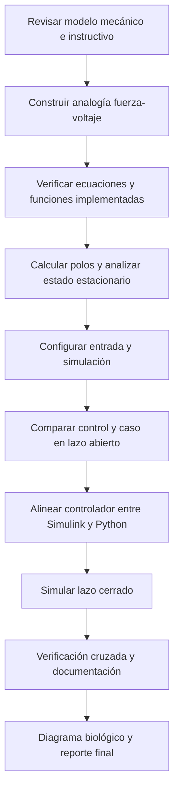

[](https://matlab.mathworks.com/)

# Práctica 3 — Modelado y control del sistema musculoesquelético

## Información de la estudiante

**Nombre completo:** Emiliano Villalobos García
**Número de control:** 23212243  
**Correo institucional:** l23212243@tectijuana.edu.mx  
**Asignatura:** Modelado de Sistemas Fisiológicos (IBF-1020)  
**Programa:** Ingeniería Biomédica

## Docente

**Dr. Paul Antonio Valle Trujillo** · paul.valle@tectijuana.edu.mx  
Departamento de Ingeniería Eléctrica y Electrónica, Tecnológico Nacional de México / Instituto Tecnológico de Tijuana, Blvd. Alberto Limón Padilla s/n, Tijuana, C.P. 22454, B.C., México.

---

<a id="contenido"></a>
## Contenido

1. [Resumen](#resumen)
2. [Competencia y objetivos](#objetivos)
3. [Relación con el temario](#temario)
4. [Modelo físico y analogía electromecánica](#analogia)
5. [Formulación matemática y función de transferencia](#modelo)
6. [Parámetros y funciones implementadas](#parametros)
7. [Análisis temporal y de estabilidad](#analisis)
8. [Señales y configuración de simulación](#senales)
9. [Implementación en Simulink, Simscape y Python](#implementacion)
10. [Control en lazo cerrado](#pid)
11. [Resultados y verificación cruzada](#resultados)
12. [Flujo de trabajo](#flujo)
13. [Actividades del estudiante](#actividades)
14. [Estructura del repositorio](#estructura)
15. [Requisitos, reproducibilidad y referencias](#reproducibilidad)
16. [Uso académico](#uso-academico)

---

<a id="resumen"></a>
## Resumen

Esta práctica analiza un modelo mecánico simplificado del sistema musculoesquelético. El modelo incorpora una fuente de fuerza activa $F_0(t)$, una fuerza transmitida $F(t)$, un amortiguador viscoso $R$, una compliancia mecánica paralela $C_p$ y una compliancia mecánica en serie $C_s$. Se utiliza la relación $F_0(t)=\alpha F(t)$, con $0<\alpha<1$.

El instructivo propone comparar un individuo sano, denominado **control**, con un caso simulado de **atrofia muscular**, denominado **caso**, al incrementar el parámetro de amortiguamiento $R$. Se construyen las representaciones matemática, de función de transferencia y de circuito eléctrico equivalente con la analogía fuerza-voltaje; además, se implementa una estrategia de control en Simulink y se reproduce la respuesta mediante Python.

> **Trazabilidad:** este README distingue el procedimiento solicitado en el instructivo de los datos extraídos de `Sistema1.slx`, `Villalobos23212243.mlx` y `Villalobos23212243.py`. No se presentan como resultados verificados las gráficas, métricas o afirmaciones que no estén respaldadas por esos archivos.

**Palabras clave:** sistema musculoesquelético; atrofia muscular; modelo viscoelástico; fuerza-voltaje; control PI; Simulink; Simscape Electrical; Python; simulación *in silico*.

[Volver al contenido](#contenido)

---

<a id="objetivos"></a>
## Competencia y objetivos

### Competencia a desarrollar

Modelizar sistemas fisiológicos mediante analogías entre sistemas físicos, ecuaciones diferenciales y funciones de transferencia para analizar su comportamiento dinámico y diseñar estrategias de control clásico.

### Objetivo general

Analizar y simular un modelo musculoesquelético viscoelástico, comparando la condición control con un caso simulado de atrofia muscular y documentando una estrategia de control *in silico*.

### Objetivos específicos

1. Identificar los elementos $F_0(t)$, $F(t)$, $R$, $C_p$, $C_s$, $x(t)$ y $x_1(t)$.
2. Construir la analogía fuerza-voltaje y explicar el cambio de topología entre los dominios mecánico y eléctrico.
3. Formular las ecuaciones del sistema y la función de transferencia de control y caso.
4. Analizar estabilidad, polos y error estacionario.
5. Implementar el modelo por ecuaciones, función de transferencia y circuito Simscape Electrical.
6. Comparar las respuestas de control, caso y tratamiento en lazo abierto y cerrado.
7. Reproducir las funciones implementadas mediante Python.
8. Elaborar el diagrama biológico y documentar resultados, archivos y discrepancias.

[Volver al contenido](#contenido)

---

<a id="temario"></a>
## Relación con el temario

| Unidad | Área | Contenidos aplicados |
|---|---|---|
| I | Sistemas de control retroalimentados | Respuesta temporal, error, polos, estabilidad y control retroalimentado |
| II | Modelado matemático | Modelo viscoelástico, analogía fuerza-voltaje, ecuaciones y función de transferencia |
| III | Controladores | Diseño y sintonización del bloque PID Controller / PI |

[Volver al contenido](#contenido)

---

<a id="analogia"></a>
## Modelo físico y analogía electromecánica

El modelo mecánico tiene dos ramas entre el punto de aplicación de la fuerza y la referencia mecánica:

- Una rama con la compliancia paralela $C_p$, cuyo desplazamiento es $x(t)$.
- Una rama con el amortiguador $R$ y la compliancia serie $C_s$; la deformación del amortiguador es $x(t)-x_1(t)$ y la de $C_s$ es $x_1(t)$.

La fuente activa cumple:

$$F_0(t)=\alpha F(t)$$

La analogía solicitada es fuerza-voltaje:

| Sistema mecánico | Sistema eléctrico equivalente |
|---|---|
| Fuerza $F(t)$ | Voltaje $V(t)$ |
| Velocidad $\dot{x}(t)$ | Corriente $I(t)$ |
| Desplazamiento $x(t)$ | Carga eléctrica $q(t)$ |
| Amortiguador | Resistencia $R$ |
| Compliancia mecánica | Capacitancia $C$ |
| Masa | Inductancia $L$ |

> En la analogía fuerza-voltaje, una conexión mecánica en paralelo puede convertirse en una conexión eléctrica en serie, y viceversa. Por ello, no se debe copiar la topología mecánica directamente al circuito eléctrico.

[Volver al contenido](#contenido)

---

<a id="modelo"></a>
## Formulación matemática y función de transferencia

Las relaciones constitutivas que se desprenden del modelo son:

$$F_p(t)=\frac{x(t)}{C_p}$$

$$F_s(t)=\frac{x_1(t)}{C_s}$$

$$F_R(t)=R\frac{d}{dt}[x(t)-x_1(t)]$$

Para construir el modelo matemático final se deben imponer las condiciones de equilibrio de fuerza de la topología de la Figura 5.3 y verificar la correspondencia con el circuito equivalente.

### Función de transferencia realmente implementada

Los bloques `Transfer Fcn` de Simulink y la función `musculo()` de Python emplean la siguiente forma:

$$G_{\mathrm{impl}}(s)=\frac{R C_s s+(1-\alpha)}{R(C_p+C_s)s+1}$$

El instructivo solicita expresar la función como $X(s)/F(s)$ cuando el desplazamiento es la salida. Sin embargo, la función implementada no contiene el integrador que normalmente relacionaría velocidad/corriente con desplazamiento/carga; además, los archivos etiquetan la salida como $F_s(t)$ o `F(t)`. Por trazabilidad, este README reporta la función como **transferencia implementada** y deja pendiente confirmar cuál variable física se está midiendo.

> `[PENDIENTE: confirmar si la salida de los bloques de función de transferencia representa desplazamiento, fuerza transmitida o voltaje de la analogía.]`

[Volver al contenido](#contenido)

---

<a id="parametros"></a>
## Parámetros y funciones implementadas

### Parámetros prescritos por el instructivo

| Parámetro | Control | Caso | Unidad de la analogía eléctrica |
|---|---:|---:|---|
| $F(t)$ | 1 | 1 | V |
| $\alpha$ | 0.25 | 0.25 | Adimensional |
| $C_s$ | 10 | 10 | $\mu\mathrm{F}$ |
| $C_p$ | 100 | 100 | $\mu\mathrm{F}$ |
| $R$ | 100 | 10 000 | $\Omega$ |

### Parámetros encontrados en los archivos

Los parámetros de los bloques de función de transferencia, Simscape y Python coinciden con los valores del instructivo: $\alpha=0.25$, $C_s=10\,\mu\mathrm{F}$, $C_p=100\,\mu\mathrm{F}$, $R_{\mathrm{control}}=100\,\Omega$ y $R_{\mathrm{caso}}=10\,\mathrm{k}\Omega$.

### Funciones de transferencia implementadas

Para control:

$$G_{\mathrm{control}}(s)=\frac{0.001s+0.75}{0.011s+1}$$

Para caso:

$$G_{\mathrm{caso}}(s)=\frac{0.1s+0.75}{1.1s+1}$$

[Volver al contenido](#contenido)

---

<a id="analisis"></a>
## Análisis temporal y de estabilidad

### Polos y ceros de las funciones implementadas

| Sistema | Polo $\mathrm{(s^{-1})}$ | Cero $\mathrm{(s^{-1})}$ | Estabilidad |
|---|---:|---:|---|
| Control | $-90.9091$ | $-750$ | Estable |
| Caso | $-0.9091$ | $-7.5$ | Estable |

El incremento de $R$ en el caso desplaza el polo hacia el origen, de $-90.9091$ a $-0.9091\,\mathrm{s^{-1}}$. En la función implementada, esto representa una respuesta mucho más lenta para el caso simulado.

### Error en estado estacionario

Las dos funciones implementadas tienen la misma ganancia estática:

$$G_{\mathrm{control}}(0)=G_{\mathrm{caso}}(0)=0.75$$

Por ello, ante un escalón de amplitud unitaria y usando estas funciones, ambas salidas convergen a $0.75$ y la diferencia estacionaria entre control y caso es:

$$e_{\mathrm{control-caso},ss}=0$$

Esto no significa que las respuestas sean iguales durante el transitorio: sus polos son muy diferentes. Para la entrada de pulso implementada, ambas señales finalmente regresan a cero después de que termina la excitación.

[Volver al contenido](#contenido)

---

<a id="senales"></a>
## Señales y configuración de simulación

El instructivo solicita respuesta a **impulso unitario** en el intervalo $0\leq t\leq10\,\mathrm{s}$. Los archivos existentes, en cambio, aplican un pulso rectangular de amplitud 1 entre $t=1\,\mathrm{s}$ y $t=2\,\mathrm{s}$:

$$u(t)=\begin{cases}1,&1\leq t<2\\0,&\text{en otro caso}\end{cases}$$

| Fuente | Tiempo final | Solver | Paso máximo / resolución | Entrada |
|---|---:|---|---|---|
| `Villalobos23212243.mlx` | $10\,\mathrm{s}$ | `ode15s` | $10^{-3}\,\mathrm{s}$ | Señal definida en `Sistema1.slx` |
| Configuración guardada en `Sistema1.slx` | `[PENDIENTE: confirmar]` | `ode15s` | $10^{-2}\,\mathrm{s}$ | Pulso discreto |
| `Villalobos23212243.py` | $10\,\mathrm{s}$ | Simulación numérica | $10^{-3}\,\mathrm{s}$ | Pulso de 1 a 2 s |

> **Discrepancia:** un pulso de duración finita no es un impulso unitario. Para cumplir literalmente el instructivo se debe sustituir la entrada por un impulso o declarar que se estudió una aproximación mediante pulso.

[Volver al contenido](#contenido)

---

<a id="implementacion"></a>
## Implementación en Simulink, Simscape y Python

| Representación | Archivo / elemento | Estado de verificación |
|---|---|---|
| Función de transferencia de control | Bloque `F(t): Control` | Coeficientes verificados |
| Función de transferencia de caso | Bloque `F(t): Caso` | Coeficientes verificados |
| Circuito equivalente | Subsistemas Control y Caso con Simscape Electrical | Parámetros de $R$, $C_p$ y $C_s$ coinciden con el instructivo |
| Cuaderno MATLAB | `Villalobos23212243.mlx` | Ejecuta `Sistema1` y grafica control, caso y tratamiento |
| Python | `Villalobos23212243.py` | Reproduce las plantas implementadas y guarda `caso_python.pdf` |

El cuaderno exporta una figura vectorial con nombre `Caso_matlab.pdf`. La función Python exporta `caso_python.pdf`. Las figuras deben compararse usando la misma entrada y el mismo controlador efectivo.

[Volver al contenido](#contenido)

---

<a id="pid"></a>
## Control en lazo cerrado

La estrategia solicitada compara la respuesta de control con la del caso y define:

$$e(t)=x_{\mathrm{control}}(t)-x_{\mathrm{caso}}(t)$$

### Controlador almacenado en Simulink

El bloque denominado `PID Controller` está configurado como **PI continuo en forma paralela**. El término derivativo está deshabilitado, aunque el campo `D` conserva un valor almacenado.

$$K_{\mathrm{SL}}(s)=k_P+\frac{k_I}{s}$$

| Parámetro | Valor |
|---|---:|
| $k_P$ | 477.1555564974 |
| $k_I$ | 1204530.19400615 |
| $k_D$ almacenado, no activo en Simulink | 0.00626997867136255 |
| Configuración | PI continuo, forma paralela |
| Sintonización registrada | `Transfer Function Based (PID Tuner App)` |

### Controlador construido en Python

El código Python recibe $k_P$, $k_I$ y $k_D$, y construye una red con $R_e$, $R_r$, $C_e$ y $C_r$. Su forma programada es:

$$K_{\mathrm{Py}}(s)=\frac{R_eR_rC_eC_r s^2+(R_eC_e+R_rC_r)s+1}{R_eC_r s}$$

con:

$$C_r=10^{-6},\qquad R_e=\frac{1}{k_IC_r},\qquad R_r=k_PR_e,\qquad C_e=\frac{k_D}{R_r}$$

> **Discrepancia importante:** el Python sí incorpora $k_D$ en la red programada, mientras que el bloque Simulink tiene el término derivativo deshabilitado. Por esta razón, las respuestas de lazo cerrado no deben declararse equivalentes hasta alinear la misma ley de control en ambas herramientas.

La función de transferencia en lazo cerrado se expresa de manera general como:

$$T(s)=\frac{K(s)G_{\mathrm{caso}}(s)}{1+K(s)G_{\mathrm{caso}}(s)}$$

[Volver al contenido](#contenido)

---

<a id="resultados"></a>
## Resultados y verificación cruzada

### Criterios de presentación académica

| Tipo | Identificación requerida |
|---|---|
| Resultado de referencia | Dato o actividad del instructivo |
| Resultado implementado | Configuración extraída de los archivos existentes |
| Resultado propio | Figura o métrica reproducida con fecha, versiones y parámetros |
| Pendiente | Marcado como `[PENDIENTE]` |

### Resultados por completar

| Comparación | Archivo de evidencia | Estado |
|---|---|---|
| Ecuaciones de Simulink vs. función de transferencia | `[PENDIENTE]` | Comparar con misma entrada |
| Función de transferencia vs. Simscape Electrical | `[PENDIENTE]` | Confirmar variable de salida y escala |
| Simulink vs. Python en lazo abierto | `[PENDIENTE]` | Alinear entrada de impulso o pulso |
| Simulink vs. Python en lazo cerrado | `[PENDIENTE]` | Alinear PI/PID efectivo |
| Control vs. caso | `[PENDIENTE]` | Reportar transitorio y error |
| Caso vs. tratamiento | `[PENDIENTE]` | Reportar efecto del controlador |

[Volver al contenido](#contenido)

---

<a id="flujo"></a>
## Flujo de trabajo



[Volver al contenido](#contenido)

---

<a id="actividades"></a>
## Actividades del estudiante

- [ ] Confirmar el nombre completo para sustituir el marcador inicial.
- [ ] Identificar y documentar la variable de salida de la función de transferencia.
- [ ] Derivar y verificar la transferencia requerida $X(s)/F(s)$ si el desplazamiento es la salida final.
- [ ] Sustituir el pulso por impulso unitario o justificar la aproximación usada.
- [ ] Alinear la ley PI/PID entre Simulink y Python.
- [ ] Exportar figuras comparativas de lazo abierto y cerrado.
- [ ] Verificar ecuaciones, función de transferencia y circuito Simscape bajo las mismas condiciones.
- [ ] Elaborar el diagrama biológico en BioRender.
- [ ] Crear `CITATION.cff` y organizar archivos, figuras y reporte.

[Volver al contenido](#contenido)

---

<a id="estructura"></a>
## Estructura del repositorio

```text
practica-3-musculoesqueletico/
├── README.md
├── CITATION.cff
├── matlab/
│   ├── Sistema1.slx
│   └── Villalobos23212243.mlx
├── python/
│   └── Villalobos23212243.py
├── simscape/
│   └── circuito_equivalente.slx
├── biorender/
│   └── diagrama_musculoesqueletico.png
├── resultados/
│   ├── Caso_matlab.pdf
│   ├── caso_python.pdf
│   ├── lazo_abierto/
│   └── lazo_cerrado/
└── reporte/
    └── practica3_reporte.pdf
```

[Volver al contenido](#contenido)

---

<a id="reproducibilidad"></a>
## Requisitos, reproducibilidad y referencias

### Requisitos

- MATLAB, Simulink, Simscape Electrical y Control System Toolbox.
- Python 3.10 o superior.
- Paquetes Python: `numpy`, `control` y `matplotlib`.
- BioRender o herramienta equivalente para el diagrama biológico.
- Git y GitHub para el repositorio y trazabilidad.

### Reproducibilidad

Registrar siempre los valores de $\alpha$, $C_s$, $C_p$, $R$, funciones de transferencia, entrada aplicada, tiempo final, solver, paso máximo, configuración PI/PID, versiones de software y fecha de ejecución.

### Referencias

1. P. A. Valle, *Práctica: Modelado y control del sistema musculoesquelético*, Modelado de Sistemas Fisiológicos, TecNM / Instituto Tecnológico de Tijuana.
2. M. C. Khoo, *Physiological Control Systems: Analysis, Simulation, and Estimation*, 2nd ed., IEEE Press, 2018.
3. F. C. Hoppensteadt y C. S. Peskin, *Modeling and Simulation in Medicine and the Life Sciences*, Springer.
4. J. E. Hall, *Guyton and Hall Textbook of Medical Physiology*, 14th ed., Elsevier, 2021.
5. K. Ogata, *Ingeniería de Control Moderna*, 5a ed., Pearson Educación, 2010.
6. N. S. Nise, *Control Systems Engineering*, 8th ed., John Wiley & Sons, 2020.

[Volver al contenido](#contenido)

---

<a id="uso-academico"></a>
## Uso académico

Este repositorio es para fines académicos y de simulación *in silico*. La estrategia de control no constituye una terapia ni una recomendación clínica para la atrofia muscular. La asistencia de IA debe declararse según las indicaciones del docente. Los datos del instructivo, los datos extraídos de las implementaciones y los resultados propios deben permanecer claramente diferenciados.
